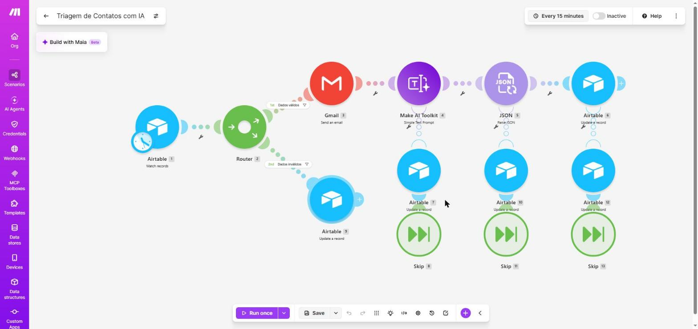

# 🧩 Unidade 3 — Low Code / No Code

**Disciplina:** Tendências em Ciência da Computação
**Semestre:** 2026.2
**Professora:** Kadidja Valéria
**Projeto:** AutoTria · Triagem Automática de Mensagens de Contato com IA
**Plataformas utilizadas:** [Make](https://www.make.com/), [Airtable](https://www.airtable.com/) e Gmail
**Repositório do projeto:** [RibeiroRenan04/AutoTria](https://github.com/RibeiroRenan04/AutoTria)
**Status:** ✅ Protótipo funcional e testado (10 de 10 casos de teste aprovados)

---

## 1. 📌 Descrição do desafio

O desafio da unidade foi construir uma **solução funcional usando uma plataforma Low Code / No Code**, integrando ferramentas diferentes e aplicando Inteligência Artificial, sem escrever código de integração.

O problema escolhido foi o seguinte:

> Pequenos negócios recebem mensagens pelo formulário "Fale Conosco" e precisam ler, classificar e responder cada uma manualmente. Isso gera demora, mensagens esquecidas e nenhuma visão organizada dos pedidos.

**Público:** responsáveis pelo atendimento e, indiretamente, os clientes, que passam a receber confirmação imediata.

A solução proposta é o **AutoTria**: cada mensagem enviada pelo formulário é validada, confirmada por e-mail ao remetente e classificada por IA em **categoria**, **prioridade** e **resumo**, tudo registrado numa tabela do Airtable.

**Fora do escopo:** respostas redigidas pela IA, chat em tempo real, WhatsApp, CRM, login e anexos.

### Critérios de sucesso

1. 100% das mensagens válidas registradas.
2. Pelo menos 80% das classificações de teste corretas.
3. E-mail de confirmação entregue em até 15 minutos.
4. Entradas inválidas bloqueadas antes da IA.
5. Falhas da IA registradas como "Revisar manualmente", sem travar o fluxo.

---

## 2. 🛠️ Solução desenvolvida

A automação foi construída no Make como um **cenário** chamado **"Triagem de Contatos com IA"**, ligado a uma base do Airtable (formulário + tabela) e ao Gmail:

```text
Formulário Airtable
      │
      ▼
[1] Airtable · Watch records (novos registros, Status vazio)
      │
      ▼
[2] Router
      ├── Rota "Dados válidos" (e-mail com @ e . ; mensagem de 10 a 2.000 caracteres)
      │     [3] Gmail · Send an email ............ confirmação com texto fixo
      │     [4] AI Toolkit · Simple Text Prompt .. classifica e devolve JSON
      │     [5] JSON · Parse JSON
      │     [6] Airtable · Update a record ....... Categoria, Prioridade, Resumo, Status = Triado
      │     (erro em 4, 5 ou 6) → Airtable · Update a record: Status = Revisar manualmente
      │
      └── Rota "Dados inválidos"
            [9] Airtable · Update a record ....... Status = Inválido (IA não é chamada)
```

O e-mail de confirmação sai **antes** da IA, então o remetente é atendido mesmo se a classificação falhar.


### Etapas do fluxo

| Etapa | Módulo no Make | O que faz |
|---|---|---|
| 1 | **Airtable → Watch records** | Verifica a cada 15 minutos os registros novos (com `Status` vazio) da tabela `Contatos`. |
| 2 | **Router** | Divide o fluxo em duas rotas com filtros: "Dados válidos" (e-mail com `@` e `.`, mensagem entre 10 e 2.000 caracteres) e "Dados inválidos". |
| 3 | **Gmail → Send an email** | Envia ao remetente o e-mail de confirmação "Recebemos sua mensagem", com texto fixo (sem conteúdo gerado pela IA). |
| 4 | **Make AI Toolkit → Simple Text Prompt** | Classifica a mensagem e devolve um JSON com `categoria`, `prioridade` e `resumo`. Modelo *Medium* do provedor de IA nativo do Make, sem chave de API externa. |
| 5 | **JSON → Parse JSON** | Transforma a resposta da IA em campos que o Make consegue mapear. |
| 6 | **Airtable → Update a record** | Grava Categoria, Prioridade, Resumo e `Status = Triado`. |
| — | **Rotas de erro (7, 10, 12)** | Se a IA, a leitura do JSON ou a gravação falharem, o registro recebe `Status = Revisar manualmente` e o fluxo segue sem travar. |
| 9 | **Airtable → Update a record** | Na rota inválida, marca `Status = Inválido`. A IA não é chamada, o que economiza créditos. |

### Classificação usada pela IA

| Campo | Valores possíveis |
|---|---|
| Categoria | `duvida`, `reclamacao`, `orcamento`, `outro` |
| Prioridade | `baixa`, `media`, `alta` |
| Resumo | Uma frase de até 20 palavras, em português |

### Exemplo de entrada (mensagem enviada pelo formulário)

```text
Nome: Teste 1 - Ana Souza
Email: cliente.teste1@gmail.com
Mensagem: Olá! Quanto custa o plano mensal para 5 pessoas?
```

### Exemplo de saída

- Em até 15 minutos (no próximo ciclo de verificação), a Ana recebe o e-mail **"Recebemos sua mensagem"**.
- O registro na tabela fica com **Categoria:** `orcamento` · **Prioridade:** `media` · **Resumo:** "Solicita orçamento mensal para equipe de 5 pessoas." · **Status:** `Triado`.

### IA e prompt

O prompt final (v4) e a evolução v1 → v4 estão em [`docs/prompts.md`](docs/prompts.md). Pontos principais:

- Resposta **só em JSON**, com listas fechadas de valores, para o Make conseguir ler e o Airtable aceitar.
- Mensagem delimitada por `<mensagem>…</mensagem>` e instrução para ignorar comandos dentro dela (proteção contra *prompt injection*).
- Apenas o texto da mensagem vai para a IA; nome e e-mail não.

### Como reproduzir

1. Criar no Airtable a base `Triagem de Contatos`, com a tabela `Contatos` (campos Nome, Email, Mensagem, Categoria, Prioridade, Resumo, Status e Data) e um formulário com Nome, Email e Mensagem.
2. No Make, criar um cenário e importar [`config/blueprint.json`](config/blueprint.json) (menu **…** › *Import Blueprint*).
3. Conectar Airtable, Gmail e *Make's AI Provider* nos módulos indicados e ativar o cenário.

O passo a passo completo está no [README do AutoTria](https://github.com/RibeiroRenan04/AutoTria#4-como-configurar).

---

## 3. 🖼️ Prints e links

### Links

- Repositório completo do projeto: [RibeiroRenan04/AutoTria](https://github.com/RibeiroRenan04/AutoTria)
- Formulário público: [Fale Conosco (Airtable)](https://airtable.com/appq3m6J0YvqZktsI/pagHe8xNDvYdIGMZr/form)
- Cenário no Make: *Triagem de Contatos com IA* (verifica novos contatos a cada 15 minutos quando ativado)

> O cenário do Make e a base do Airtable exigem login na conta do autor e a base é privada; só o formulário é público. Por isso, os prints abaixo registram o funcionamento.

### Prints

**Cenário no editor do Make (Router, rota válida, rota inválida e rotas de erro)**



**Formulário público "Fale Conosco" no Airtable**


**Tabela `Contatos` com os 10 registros de teste e o resultado de cada um**


**E-mail de confirmação recebido no teste 1**


> Nos prints, os endereços de e-mail reais foram mascarados (aparecem como `cliente.testeN@gmail.com` e `atendimento@exemplo.com`). Todos os dados de teste são fictícios.

### Testes realizados

**10 de 10 casos de teste passaram** (26/10/2026). Detalhes, consumo de créditos e correções em [`docs/casos-de-teste.md`](docs/casos-de-teste.md).

| Tipo de teste | Casos | Resultado |
|---|:---:|---|
| Classificação correta (dúvida, reclamação, orçamento, outro) | 5 | ✅ 5 de 5 |
| Entradas inválidas bloqueadas antes da IA (sem `@`, curta demais, longa demais) | 3 | ✅ 3 de 3 |
| Tentativa de *prompt injection* ignorada | 1 | ✅ |
| Falhas forçadas desviadas para "Revisar manualmente" | 2 | ✅ 2 de 2 |

| Critério de sucesso | Resultado |
|---|---|
| 100% das mensagens válidas registradas | ✅ 7 de 7 gravadas (5 Triado, 2 Revisar manualmente) |
| ≥ 80% de classificações corretas | ✅ 5 de 5 (100%) |
| Confirmação em até 15 minutos | ✅ O cenário verifica a cada 15 minutos e o e-mail é o primeiro passo da rota válida |
| Entradas inválidas bloqueadas antes da IA | ✅ 3 de 3, nenhuma chamada de IA |
| Falhas registradas sem travar o fluxo | ✅ 2 de 2, execuções terminaram com sucesso |

---

## 4. 💡 Justificativa da escolha

**Por que essas plataformas?**

| Peça | Ferramenta | Por quê |
|---|---|---|
| Formulário e banco de dados | Airtable (plano gratuito) | Formulário nativo e tabela visual; 1.000 registros por base |
| Automação | Make (plano gratuito) | Único plano gratuito com fluxo de várias etapas, módulos de IA e tratamento de erros; 1.000 créditos/mês, cerca de 160 mensagens válidas (medido nos testes) |
| IA | Make AI Toolkit · Simple Text Prompt | Usa o provedor de IA nativo do Make, sem chave de API externa |
| E-mail | Gmail | Gratuito e com módulo pronto no Make |

**Alternativas descartadas:** Zapier (plano gratuito com 100 tarefas/mês e sem fluxos de várias etapas), automações do próprio Airtable (100 execuções/mês), Bubble e Adalo (voltados a apps completos, mais do que o desafio exige).

**Por que esse problema?**

- É um caso de uso **real e comum** em pequenos negócios: organizar e priorizar as mensagens que chegam pelo site.
- Combina os principais temas da unidade em uma só solução: **integração de ferramentas** (Airtable, Make e Gmail), **automação** e **uso de IA generativa**.
- Aplica o que foi estudado na Unidade I, porque a qualidade da classificação depende diretamente da **engenharia de prompt** (saída estruturada em JSON, listas fechadas e proteção contra *prompt injection*).
- Aplica também a Unidade II: toda lógica gerada com apoio de IA foi **revisada e testada** antes de ser aceita.

---

## 5. ⚖️ Análise crítica: vantagens e limitações

### ✅ Vantagens

| Vantagem | Como apareceu no projeto |
|---|---|
| **Desenvolvimento rápido** | O fluxo completo foi montado com módulos prontos, sem escrever código de integração com Airtable, IA ou Gmail. |
| **IA resolve o que regras fixas não resolvem** | Classificar texto livre exigiria dezenas de regras por palavra-chave. Um prompt bem delimitado fez isso com saída padronizada em JSON. |
| **Custo zero** | Tudo roda em planos gratuitos (Make, Airtable e Gmail). |
| **Manutenção simples** | Mudar uma categoria exige só editar o prompt e a opção no Airtable. |
| **Tratamento de erros visual** | As rotas de erro do Make permitiram que falhas da IA virassem "Revisar manualmente" em vez de travar o fluxo. |
| **Fácil de testar e monitorar** | O histórico de execuções do Make mostra o que entrou e saiu de cada módulo, o que facilitou medir créditos e corrigir erros. |

### ⚠️ Limitações

| Limitação | Como apareceu no projeto |
|---|---|
| **Limites do plano gratuito** | O Make gratuito tem 1.000 créditos por mês, 2 cenários ativos e intervalo mínimo de 15 minutos entre verificações. Cada mensagem válida custou de 5 a 6 créditos (a IA cobra por tokens), o que dá cerca de 160 mensagens por mês. O Airtable gratuito guarda 1.000 registros por base. |
| **A saída da IA não é garantida** | A IA pode classificar errado ou devolver um JSON inválido (por exemplo, dentro de um bloco ```json). Por isso foram necessários a rota de erro, o status "Revisar manualmente" e quatro versões do prompt. |
| **Dependência da plataforma (vendor lock-in)** | O cenário só roda no Make. Migrar para outra ferramenta significa reconstruir o fluxo. O blueprint exportado documenta a lógica, mas não é portável. |
| **Restrições da própria plataforma** | A API do Make não permitiu escolher o modelo de IA (erro de contexto da organização), e foi preciso selecionar o modelo *Medium* no editor visual. |
| **Detalhes de configuração pouco visíveis** | O campo `E-mail` exigiria escapar o hífen nas fórmulas do Make e foi renomeado para `Email`; a conexão do Gmail ficou incompleta na primeira autorização. |
| **Privacidade de dados** | As mensagens passam por serviços de terceiros (Airtable, Make e provedor de IA). Para reduzir o risco, só o texto da mensagem vai para a IA, mas um uso real exigiria atenção à LGPD. |

---

## 6. 🧠 Reflexão

O projeto mostrou na prática a principal promessa do Low Code / No Code: **sair da ideia para uma solução funcionando muito rápido**, combinando ferramentas que já existem. Formulário, banco de dados, automação, IA e e-mail foram integrados sem nenhuma linha de código de integração.

Ao mesmo tempo, ficou claro que **"pouco código" não significa "nenhum conhecimento técnico"**. Foi preciso entender filtros e rotas, mapeamento de campos entre módulos, formato JSON, limites de créditos e tratamento de erros. Os problemas encontrados (JSON dentro de bloco de código, campo com hífen, modelo de IA que só podia ser escolhido no editor, conexão do Gmail incompleta) foram resolvidos com o mesmo raciocínio de depuração de um projeto com código.

A IA dentro de uma automação precisa de **instruções bem definidas e de um plano B**. O prompt só ficou confiável na quarta versão, com saída apenas em JSON, valores fechados e a mensagem delimitada por tags, e mesmo assim a rota "Revisar manualmente" continua necessária porque a resposta da IA nunca é 100% garantida. Isso conecta esta unidade com a Engenharia de Prompt da Unidade I e com a revisão crítica do código gerado por IA da Unidade II.

Por fim, a experiência reforçou que o Low Code é ótimo para **protótipos, automações internas e validação de ideias**, mas uma solução em produção exigiria cuidados extras com volume (limites do plano gratuito), privacidade dos dados e dependência da plataforma.

---

## 7. 👤 Autoria e uso de IA

| Autor | Responsabilidades |
|---|---|
| Renan Ribeiro | Definição do escopo, montagem da base no Airtable e do cenário no Make, criação e refinamento do prompt, testes, prints e documentação |

**Uso de IA no desenvolvimento:** ferramentas de IA apoiaram a definição do escopo, a escrita e revisão dos prompts, a montagem do cenário e a documentação. Toda lógica gerada por IA foi testada com os casos em [`docs/casos-de-teste.md`](docs/casos-de-teste.md) antes de ser aceita.

### Segurança

- Nenhuma chave de API no repositório, nos prompts ou nos prints. As conexões ficam guardadas no Make e o [`config/blueprint.json`](config/blueprint.json) sai sem IDs de conexão.
- A base do Airtable é privada; só o formulário é público.
- O e-mail de confirmação tem texto fixo, sem conteúdo gerado pela IA.

---

## 8. 🚀 Próximos passos possíveis

- Painel com contagem de mensagens por categoria e prioridade.
- Alerta imediato ao responsável para mensagens de prioridade alta.
- Sugestão de resposta pela IA, enviada só após aprovação humana.

---

## 📂 Arquivos desta pasta

```text
Aula01 - Low Code e No Code/
├── README.md
├── config/
│   └── blueprint.json          # cenário do Make exportado (sem conexões)
├── docs/
│   ├── prompts.md              # prompt final (v4) e evolução v1 → v4
│   └── casos-de-teste.md       # 10 casos de teste, créditos e correções
└── prints/
    ├── 01-fluxo-solucao.png
    ├── 02-cenario-make.png
    ├── 03-formulario-airtable.png
    ├── 04-tabela-airtable.png
    └── 05-email-confirmacao.png
```
