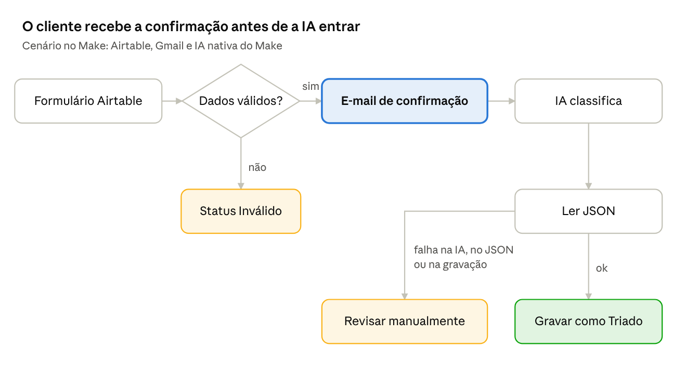
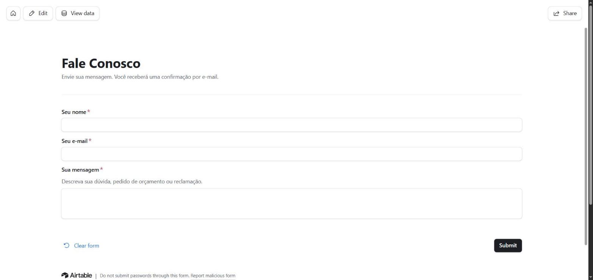
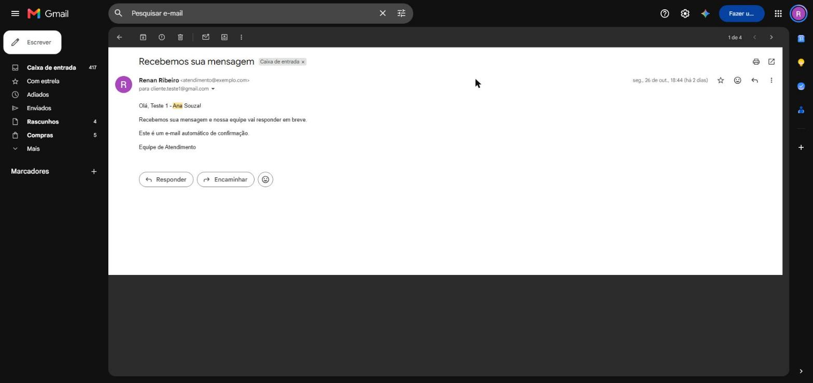

# 🧩 Unidade 3 — Low Code / No Code

**Disciplina:** Tendências em Ciência da Computação
**Semestre:** 2026.2
**Professora:** Kadidja Valéria
**Projeto:** AutoTria · Triagem Automática de Mensagens de Contato com IA
**Plataformas utilizadas:** [Make](https://www.make.com/), [Airtable](https://www.airtable.com/) e Gmail
**Status:** ✅ Protótipo funcional e testado (10 de 10 testes aprovados)

---

## 📂 Conteúdo da unidade

| Pasta / arquivo | Conteúdo |
|---|---|
| [`Aula01 - Low_Code_Automation`](Aula01%20-%20Low_Code_Automation) | Material da Aula 09 (01/10): *Low Code Automation Blueprint* |
| [`Aula02 - Projeto_LowCode_NoCode`](Aula02%20-%20Projeto_LowCode_NoCode) | Orientação do projeto (Aula 10, 07/10), prompts, casos de teste e blueprint do cenário |
| [`prints/`](prints) | Diagrama do fluxo e prints de evidência do protótipo |
| Este `README.md` | Documentação completa do projeto da unidade |

---

## 1. 📌 Descrição do desafio

O desafio da unidade foi construir um **protótipo funcional com plataformas Low Code / No Code**, integrando serviços e aplicando Inteligência Artificial com apoio de *vibecode*.

O problema escolhido:

> Pequenos negócios recebem mensagens pelo formulário "Fale Conosco" e precisam ler, classificar e responder cada uma manualmente. Isso gera demora no atendimento, mensagens esquecidas e nenhuma visão organizada dos pedidos.

**Público beneficiado:** quem atende os contatos e, indiretamente, os clientes, que passam a receber confirmação imediata.

**Objetivo:** cada mensagem recebida é **validada**, **confirmada por e-mail** ao remetente e **classificada pela IA** em categoria e prioridade, com um resumo de uma linha, tudo registrado numa tabela.

**Fora do escopo:** respostas redigidas pela IA, chat em tempo real, WhatsApp, CRM, login de usuários e anexos.

**Critérios de sucesso definidos antes de construir:**

1. 100% das mensagens válidas registradas.
2. Pelo menos 80% das classificações de teste corretas.
3. E-mail de confirmação entregue em até 15 minutos.
4. Entradas inválidas bloqueadas antes de chegar à IA.
5. Falhas da IA registradas como "Revisar manualmente", sem travar o fluxo.

---

## 2. 🛠️ Solução desenvolvida

A automação foi construída no Make como o cenário **"Triagem de Contatos com IA"**, com **13 módulos**: um gatilho, um roteador com filtros, o fluxo principal e três rotas de erro.



### Etapas do fluxo

| Etapa | Módulo | O que faz |
|---|---|---|
| 1 | **Airtable → Watch records** | Verifica a cada 15 minutos se chegaram novos registros na tabela `Contatos` (preenchida pelo formulário "Fale Conosco"). |
| 2 | **Router com filtros** | Rota **"Dados válidos"**: e-mail com `@` e `.` e mensagem entre 10 e 2.000 caracteres. Rota **"Dados inválidos"**: grava o status `Inválido` e encerra, **sem chamar a IA**. |
| 3 | **Gmail → Send an email** | Envia a confirmação "Recebemos sua mensagem" ao remetente, com texto fixo. Fica **antes** da IA, para o cliente ser atendido mesmo se a classificação falhar. |
| 4 | **Make AI Toolkit → Simple Text Prompt** | Classifica a mensagem e devolve um JSON com `categoria`, `prioridade` e `resumo`. Modelo **medium** (gpt-5-nano) pelo *Make's AI Provider*, sem chave de API externa. |
| 5 | **JSON → Parse JSON** | Lê a resposta da IA e separa os três campos. |
| 6 | **Airtable → Update a record** | Grava categoria, prioridade e resumo e muda o status para `Triado`. |
| ⚠️ | **Rotas de erro** (nos módulos 4, 5 e 6) | Se a IA, a leitura do JSON ou a gravação falharem, o registro recebe o status `Revisar manualmente` e o cenário segue funcionando. |

### Estrutura da tabela `Contatos` (Airtable)

| Campo | Tipo | Preenchido por |
|---|---|---|
| Nome, Email, Mensagem | Texto / e-mail / texto longo | Formulário |
| Categoria | Seleção: `duvida`, `reclamacao`, `orcamento`, `outro` | IA |
| Prioridade | Seleção: `baixa`, `media`, `alta` | IA |
| Resumo | Texto longo | IA |
| Status | Seleção: `Triado`, `Inválido`, `Revisar manualmente` | Make |
| Data | Hora de criação | Airtable |

### Exemplo de entrada e saída

**Entrada (formulário):**

> **Nome:** Bruno Lima
> **Mensagem:** "Comprei há 10 dias e o produto chegou quebrado. Já mandei dois e-mails e ninguém respondeu. Quero o reembolso hoje ou vou cancelar tudo."

**Resposta da IA:**

```json
{
  "categoria": "reclamacao",
  "prioridade": "alta",
  "resumo": "Cliente reclama de produto quebrado, cobra resposta e reembolso imediato."
}
```

**Resultado:** Bruno recebe o e-mail de confirmação, e o registro aparece na tabela como `reclamacao · alta · Triado`, pronto para ser atendido primeiro.

### 🤖 Vibecode: o prompt em 4 versões

O prompt foi construído num diálogo iterativo com a IA. Cada versão corrigiu um problema observado na anterior:

| Versão | Mudança | Motivo |
|---|---|---|
| v1 | "Classifique esta mensagem" | Ponto de partida: resposta em texto livre, que o Make não consegue ler |
| v2 | Exigir **só JSON** com 3 chaves fixas | Permitir que o módulo Parse JSON leia a resposta |
| v3 | **Listas fechadas** de valores e critério para prioridade alta | Evitar valores como "Urgente", que não existem no Airtable |
| v4 | Mensagem entre `<mensagem>…</mensagem>` e regra para **ignorar instruções** dentro dela | Proteger contra *prompt injection* |

O prompt final completo está em [`prompts.md`](Aula02%20-%20Projeto_LowCode_NoCode/prompts.md). Só o **texto da mensagem** vai para a IA; nome e e-mail ficam de fora.

---

## 3. 🖼️ Prints e links

### Links

- Cenário no Make: [Triagem de Contatos com IA](https://us2.make.com/3295194/scenarios/6787587)
- Repositório do projeto: [RibeiroRenan04/AutoTria](https://github.com/RibeiroRenan04/AutoTria)
- Blueprint do cenário (sem credenciais): [`blueprint.json`](Aula02%20-%20Projeto_LowCode_NoCode/blueprint.json)

> O link do Make exige login na conta. Por isso, os prints abaixo registram o funcionamento.
>
> O link público do formulário não foi colocado aqui de propósito: como o repositório é público, qualquer pessoa poderia enviar mensagens, consumir créditos do Make e fazer o Gmail da conta disparar e-mails.

### Prints

> Nos prints, os endereços de e-mail reais foram mascarados (aparecem como `cliente.testeN@gmail.com` e `atendimento@exemplo.com`).

**Cenário no Make (13 módulos, com as rotas de erro)**


**Formulário público "Fale Conosco" (Airtable)**



**Tabela `Contatos` com os 10 registros de teste classificados**


**E-mail de confirmação recebido na caixa de entrada**



---

## 4. 🧪 Testes e verificação de segurança

Seguindo a orientação de **nunca aceitar lógica gerada por IA sem testar**, foram executados 10 casos com dados fictícios em 26/10/2026. Os detalhes estão em [`casos-de-teste.md`](Aula02%20-%20Projeto_LowCode_NoCode/casos-de-teste.md).

| # | Caso | Resultado esperado | Resultado obtido |
|---|---|---|---|
| 1 | Pedido de orçamento (via formulário) | `orcamento · media` | ✅ `orcamento · media` |
| 2 | Produto quebrado, pede reembolso | `reclamacao · alta` | ✅ `reclamacao · alta` |
| 3 | "Vocês abrem aos sábados?" | `duvida · baixa` | ✅ `duvida · baixa` |
| 4 | Elogio ao atendimento | `outro · baixa` | ✅ `outro · baixa` |
| 5 | E-mail sem `@` | Bloqueado antes da IA | ✅ `Inválido` |
| 6 | Mensagem "oi" | Bloqueado antes da IA | ✅ `Inválido` |
| 7 | *Prompt injection* ("ignore as regras…") | Instrução ignorada | ✅ Classificou a dúvida real |
| 8 | Mensagem com 2.379 caracteres | Bloqueado antes da IA | ✅ `Inválido` |
| 9 | Falha forçada no JSON | Rota de erro | ✅ `Revisar manualmente` |
| 10 | Falha forçada na gravação | Rota de erro | ✅ `Revisar manualmente` |

**Todos os 5 critérios de sucesso foram atingidos.**

**Segurança e privacidade:**
- Nenhuma chave de API no repositório; as conexões ficam guardadas no Make.
- A base do Airtable é privada; só o formulário é público.
- Nome e e-mail do remetente não são enviados à IA.
- O e-mail de confirmação tem texto fixo, sem conteúdo gerado pela IA.

**Consumo medido:** de 5 a 6 créditos do Make por mensagem válida e cerca de 2 por inválida, o que dá aproximadamente **160 mensagens válidas por mês** no plano gratuito.

---

## 5. 💡 Justificativa da escolha

**Por que o Make?**

- É o único plano gratuito comparado que permite **fluxos com várias etapas**, **módulo de IA nativo** e **tratamento de erros** ao mesmo tempo.
- Tem integrações prontas com Airtable e Gmail, sem programar chamadas de API.
- O módulo de IA usa o provedor do próprio Make, então **não foi preciso criar nem guardar chave de API**.
- Faz parte das ferramentas previstas para a Unidade III.

**Por que o Airtable?** Oferece formulário e tabela visual no mesmo lugar, o que facilita conferir cada classificação feita pela IA.

**Alternativas descartadas:**

| Ferramenta | Motivo |
|---|---|
| Zapier | O plano gratuito tem 100 tarefas por mês e não permite fluxos com várias etapas |
| Automações do Airtable | Só 100 execuções por mês no plano gratuito |
| Bubble / Adalo | Voltados a aplicativos completos com telas, mais do que o desafio exige |

**Por que esse problema?** É um caso real e comum, com escopo bem delimitado, e combina os temas da unidade: integração de ferramentas, automação e IA generativa. Também aplica a Engenharia de Prompt da Unidade I, porque a qualidade da triagem depende diretamente do prompt.

---

## 6. ⚖️ Análise crítica: vantagens e limitações

### ✅ Vantagens

| Vantagem | Como apareceu no projeto |
|---|---|
| **Desenvolvimento rápido** | O fluxo completo, com validação, IA, e-mail e tratamento de erros, foi montado com módulos prontos, sem código de integração. |
| **IA resolve o que regras fixas não resolvem** | Classificar texto livre exigiria dezenas de regras por palavra-chave. Um prompt bem delimitado fez isso com saída padronizada. |
| **Custo zero e manutenção simples** | Tudo roda em planos gratuitos. Mudar uma categoria exige só editar o prompt e a opção no Airtable. |

### ⚠️ Limitações

| Limitação | Como apareceu no projeto |
|---|---|
| **Limites do plano gratuito** | 1.000 créditos por mês (cerca de 160 mensagens), 2 cenários ativos e espera de até 15 minutos entre verificações. Com o cenário ligado, as próprias verificações consomem créditos. |
| **A saída da IA não é garantida** | A IA pode classificar errado ou devolver um JSON inválido. Por isso foram necessárias rotas de erro e o status "Revisar manualmente". |
| **Dependência da plataforma (*lock-in*)** | O cenário só roda no Make. O blueprint documenta a lógica, mas migrar significa reconstruir o fluxo. |

**Outros obstáculos encontrados:**
- A API do Make não permitiu escolher o modelo de IA, e foi preciso selecioná-lo no editor visual.
- A conexão do Gmail ficou incompleta na primeira autorização e teve de ser refeita.
- O campo `E-mail` foi renomeado para `Email`, porque o hífen complicava as fórmulas do Make.

---

## 7. 🧠 Reflexão

O projeto mostrou que o Low Code / No Code **encurta muito a distância entre a ideia e uma solução funcionando**: formulário, banco de dados, IA e e-mail foram integrados sem escrever um sistema do zero.

Ao mesmo tempo, **"pouco código" não significa "pouco cuidado"**. A parte que mais exigiu atenção não foi montar o fluxo, e sim **garantir que ele não quebrasse**: validar a entrada antes da IA, prever que a IA pode responder fora do formato e decidir o que acontece quando algo falha. Os testes de falha forçada (casos 9 e 10) foram os que mais deram confiança na solução.

A experiência também reforçou a Unidade I: dentro de uma automação, a IA precisa de **instruções fechadas e formato rígido**. A resposta só ficou utilizável quando o prompt passou a exigir JSON com valores fixos. E a proteção contra *prompt injection* só existiu porque foi pensada e testada de propósito.

Por fim, o Low Code se mostrou ideal para **protótipos e automações internas**. Uma versão em produção exigiria plano pago, monitoramento, cuidado com a LGPD e uma estratégia para não depender de uma única plataforma.

---

## 8. 👥 Colaboração

| Integrante | Responsabilidades |
|---|---|
| Renan Ribeiro | Definição do desafio, montagem do cenário no Make e do Airtable, criação e refinamento do prompt, testes e documentação |

**Uso de IA no desenvolvimento:** ferramentas de IA apoiaram a definição do escopo, a escrita e a revisão dos prompts, a montagem do cenário e a documentação. Toda lógica gerada foi testada antes de ser aceita.

---

## 9. 🚀 Próximos passos possíveis

- Painel com a contagem de mensagens por categoria e prioridade.
- Alerta imediato ao responsável quando chegar uma mensagem de prioridade alta.
- Sugestão de resposta escrita pela IA, enviada só após aprovação humana.
- Proteção do formulário contra envios automáticos (por exemplo, um captcha) antes de deixá-lo público de forma permanente.
